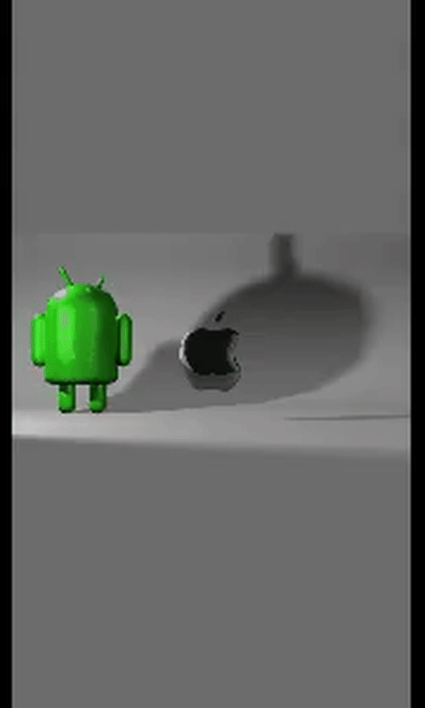

# 📽️ Apple electrocution-bootanimation
Apple electrocution bootanimation for google pixel. Only for pixel!!!!

<p align="center">
  
</p>

## 📱 Tested device
- Google Pixel 9a (Stock firmware)
- Google Pixel 8a (Stock firmware)
- Google Pixel 7a (LineageOS)
## 🚀Installation
1. Install the zip form [release](https://github.com/axy0n-qli/Apple-electrocution-bootanimation/releases/latest)
2. Open Magisk (or other root manager)
3. Go to Modules click on + and install from storage
4. Select your zip confirm installation and reboot

### 🤓 Building from source
```bash
git clone https://github.com/axy0n-qli/Apple-electrocution-bootanimation
cd Apple-electrocution-bootanimation
make
```
## 👨‍💻 Contribute?
Contact me on Discord. See my profile.

## 📄 License

This project is open-source and released under the **GNU General Public License v3.0 (GPLv3)**. Feel free to modify and distribute it under the terms of the GPLv3 license. See the [LICENSE](LICENSE) file for more details.
